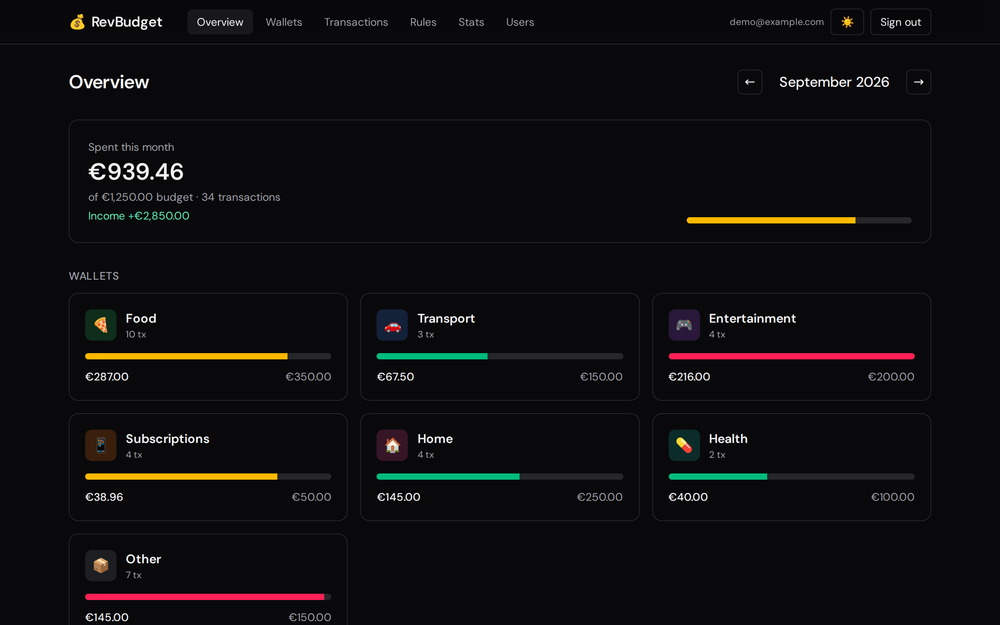
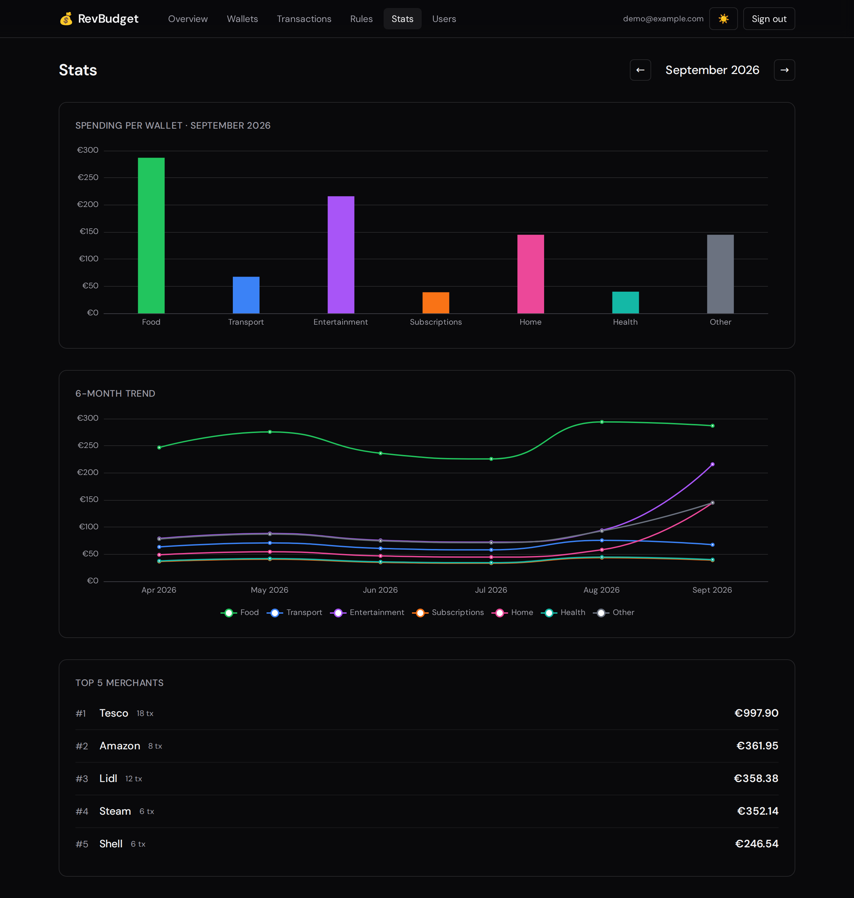
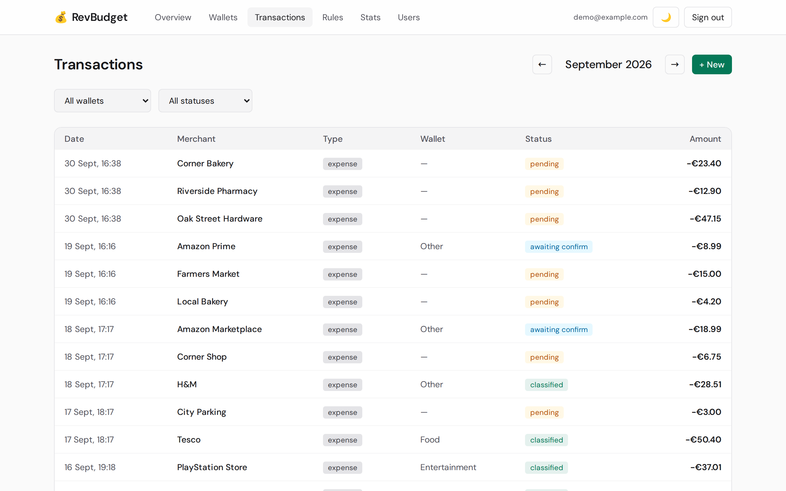
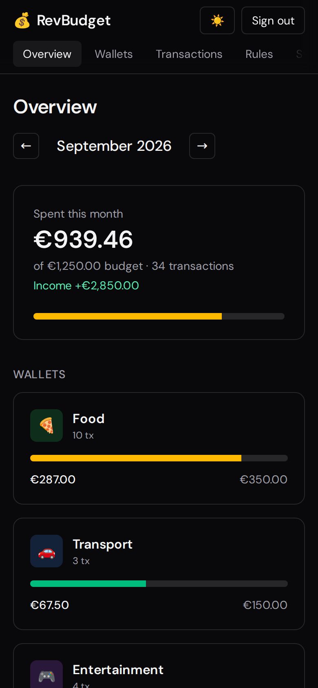
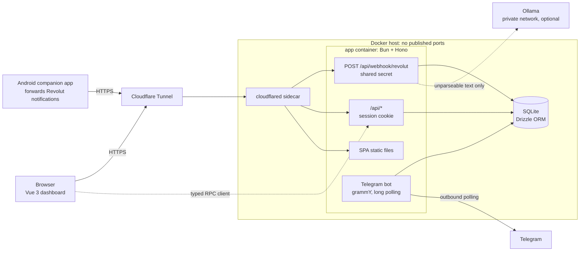

# RevBudget

**A self-hosted budget tracker that fills itself in.** Revolut push notifications become categorized transactions. You confirm them with one tap in Telegram and see them charted in a Vue dashboard.

[](https://github.com/Pablodvs/revbudget/actions/workflows/ci.yml)
[](LICENSE)
[](https://bun.sh)
[](tsconfig.base.json)



| Stats | Light theme | Mobile |
|---|---|---|
|  |  |  |

## Why it's interesting

- **No data entry and no open ports.** A phone forwards bank notifications to a webhook that is reachable only through a Cloudflare Tunnel. The host publishes nothing.
- **Deterministic first, LLM second, human last.** Bounded regexes parse the known formats. A local Ollama model only rescues the rest, and its answer counts only if the same parser reproduces it *and* a human confirms it.
- **Type-safe end to end.** Shared Zod schemas validate the webhook and every API input, and the environment is Zod-validated at boot. The Vue dashboard calls Hono through a typed RPC client, so a renamed field is a compile error, not a runtime bug. Money is integer cents everywhere.
- **Security as a feature.** It has a written threat model and two recorded reviews with every finding traced to a fix. The container is hardened, and a black-box auth harness runs against the live deployment.

## Architecture



A notification is parsed and matched against merchant rules. It's then classified automatically, held for a one-tap confirmation, or queued as pending. The details, with a flow diagram, are in [docs/usage.md](docs/usage.md#how-a-notification-is-processed).

## Features

- **Webhook ingest.** English Revolut notifications (expenses, income, refunds; €, $ and £), behind a shared secret and a per-IP rate limit.
- **Rules that learn.** `exact` and whole-word `contains` merchant rules. Classifying a merchant once teaches the rule, and each rule can require confirmation.
- **Telegram bot** (optional). One tap to classify, confirm, ignore or undo, plus `/status` and `/wallets`.
- **Dashboard:**
  - a monthly overview with budget progress per wallet;
  - wallet detail with a cumulative-spend chart;
  - a filterable transaction ledger with manual entries, refunds and adjustments;
  - rules management;
  - 6-month trends and top merchants;
  - light and dark themes and a mobile layout.
- **Invite-only accounts.** An admin manages users, and there's no public sign-up.
- **Local LLM fallback** (optional). Ollama normalizes notifications the parser doesn't know, so notification text never leaves your network.

## Quickstart

Requires [Bun](https://bun.sh) ≥ 1.2 and `openssl`. No Revolut, Telegram or Ollama needed.

```bash
git clone https://github.com/Pablodvs/revbudget.git
cd revbudget
bun install
cp .env.example .env

# Fill both secrets with random 64-char hex (GNU sed; on macOS use: sed -i '' …)
sed -i "s/^WEBHOOK_SECRET=.*/WEBHOOK_SECRET=$(openssl rand -hex 32)/; s/^BETTER_AUTH_SECRET=.*/BETTER_AUTH_SECRET=$(openssl rand -hex 32)/" .env

bun run db:migrate
bun run db:seed:demo   # 7 wallets, 6 months of sample transactions, 5 rules, a demo login
bun run dev            # API on :3000, dashboard on :5173
```

Open **<http://localhost:5173>** and sign in as **`demo@example.com`** / **`revbudget-demo`**.

Then play the phone: from a second terminal in the repo, send a notification the way the Android app would.

```bash
curl -s http://localhost:3000/api/webhook/revolut \
  -H 'Content-Type: application/json' \
  -H "X-Webhook-Secret: $(grep '^WEBHOOK_SECRET=' .env | cut -d= -f2)" \
  -d '{"text": "You paid €12.50 at Corner Bakery"}'
```

The reply shows how it was handled (`pending` unless one of the demo rules matches). The transaction appears under **Transactions**. Give it a wallet, and the next charge from that merchant is classified automatically.

To go further, see:

- [docs/usage.md](docs/usage.md#telegram-bot): connect the Telegram bot.
- [docs/deploy.md](docs/deploy.md): run the production image.

## Tech choices

| Choice | Why |
|---|---|
| **Bun** | One tool for the runtime, package manager, test runner and bundler, with a built-in SQLite driver. Small and fast on a home server. |
| **Hono** | Web-standard `Request`/`Response`, tiny, and its `hc<AppType>` client gives the dashboard end-to-end types with no codegen. |
| **SQLite + Drizzle** | A single-household workload doesn't need a database server: one file to back up. Drizzle provides a typed query builder, committed SQL migrations and no raw SQL. |
| **Zod, in a shared package** | One set of schemas validates webhook bodies and API input, and their inferred types reach the dashboard through the RPC client. The env is Zod-validated at boot too. |
| **better-auth** | Cookie sessions, an admin plugin, Origin checks and rate limiting without hand-rolled crypto. |
| **Vue 3, TanStack Query, Tailwind v4, ECharts** | A small reactive SPA with cache-aware data fetching and tree-shaken charts. |
| **grammY (long polling)** | The bot needs no public URL or inbound webhook. |
| **Ollama** | A local model, so bank notification text never goes to a third-party API. |
| **Cloudflare Tunnel** | Public HTTPS with zero open ports and no reverse proxy to maintain. |
| **Biome** | Linting and formatting in one fast tool, enforced in CI. |

## Security

**Threat model in three sentences.** RevBudget puts a household's financial history on the public internet, so only invited people should be able to read or change it, and nobody should be able to forge or corrupt transactions. There are three ways in: a browser session, the webhook secret and the Telegram chat allowlist. Each is authenticated, rate-limited and validated on its own, and everything else (notification text, LLM output) is treated as untrusted data. The host exposes no ports, and the container assumes it could be compromised: it runs as non-root, holds no capabilities it doesn't need, and can't modify its own code.

| Control | Where | Why |
|---|---|---|
| Tunnel-only ingress, no published ports | `docker-compose.yml` | Nothing to port-scan; Cloudflare terminates TLS |
| Invite-only cookie sessions: `HttpOnly`, `Secure`, `SameSite=Lax`, 7-day expiry | `server/src/lib/auth.ts` | No tokens reachable from JS; stolen sessions expire |
| Sign-in limited to 5/min per IP, no account enumeration | `server/src/lib/auth.ts` | Password guessing |
| Exact-match origin allowlist plus better-auth Origin check | `server/src/config.ts`, `server/src/app.ts` | CSRF and cross-origin reads |
| Webhook rate limit *before* a timing-safe secret check | `server/src/routes/webhook.ts` | Forged notifications, brute force, flooding |
| Zod on every input, 64 KB body limit, amounts capped at €1M | `shared/src/schemas.ts`, `server/src/app.ts` | Malformed input and ledger corruption |
| Linear-time notification parser with a ReDoS regression test | `server/src/services/notification-parser.ts` | One crafted notification can't freeze the single-threaded server |
| LLM output re-parsed, round-trip checked and always human-confirmed | `server/src/services/ollama-normalizer.ts` | Prompt injection can't write arbitrary transactions |
| Strict CSP, HSTS, `Cache-Control: no-store` on the API | `server/src/app.ts` | Contains XSS; keeps financial data out of caches |
| Fail-fast env validation, placeholder secrets rejected | `server/src/config.ts` | A misconfigured deploy can't boot with public secrets |
| Non-root, `cap_drop: ALL`, `no-new-privileges`, app code read-only to the runtime user | `Dockerfile`, `docker-compose.yml` | Limits what a compromised process can do |
| SHA-pinned CI actions, digest-pinned images, frozen lockfile, Dependabot | `.github/`, `Dockerfile` | Supply chain |

**Authorization model.** Accounts are invite-only. Every signed-in user has full access to wallets, transactions and rules, and the `admin` role only gates user management (enforced server-side by better-auth's admin plugin). It's single-tenant by design, for a household that already shares its finances.

The full threat model and how to report a vulnerability are in [SECURITY.md](SECURITY.md). The past reviews, with every finding mapped to its fix, are in [docs/security/](docs/security/).

## Testing and quality

- **`bun test`** runs 100+ tests against the real Hono app and a real, migrated SQLite database. They cover the parser, including linear-time checks on hostile input; the classifier; the rate limiter; the session guard; the routes; and month boundaries across DST changes.
- **`bun run typecheck`** runs `strict` TypeScript with `noUncheckedIndexedAccess` across all three workspaces. **`bunx biome ci .`** lints and checks formatting.
- **CI** runs all of the above plus the production build on every pull request and every push to master. It then builds the Docker image and smoke-tests it under the production hardening flags: health, a 401 on an authenticated route, and that the runtime user can't write its own code.
- **`bun run qa:auth`** is a black-box check of a live, production-mode deployment. It covers cookie flags, CSP and CORP, CORS against a foreign origin, disabled sign-up, the admin role, sign-out invalidation and the sign-in rate limit. It caught a real bug: `bun build` had inlined `NODE_ENV=development` into the server bundle, which silently turned better-auth's rate limiter off in the image.

## Deployment

The app ships as a single Docker image containing the API, the dashboard and SQLite, with migrations run by the entrypoint. `docker compose up -d --build` starts it. With `COMPOSE_PROFILES=tunnel`, a pinned `cloudflared` sidecar publishes it through a Cloudflare Tunnel, and the compose file works unchanged on Coolify. For environment variables, a local no-tunnel recipe, Coolify steps, safe Ollama networking and backups, see **[docs/deploy.md](docs/deploy.md)**.

## Project layout

```
revbudget/
├── server/             Bun + Hono backend
│   └── src/
│       ├── routes/       wallets, transactions, merchant-rules, stats, webhook
│       ├── services/     notification parser, classifier, Ollama normalizer, Telegram bot
│       ├── middleware/   session guard, webhook secret, rate limiter, error handler
│       ├── db/           Drizzle schema, SQL migrations, seeds
│       └── config.ts     Zod-validated environment
├── dashboard/          Vue 3 SPA (Vite, Tailwind v4, TanStack Query, ECharts)
├── shared/             Zod schemas and money/date helpers used by both sides
├── scripts/qa-auth.ts  end-to-end auth check against a deployment
├── docker/             container entrypoint
├── docs/               usage, deployment, security reviews
└── Dockerfile · docker-compose.yml · .env.example
```

## Limitations and roadmap

- **Single-tenant.** Every invited user sees all data. Per-household isolation would be the next step for real multi-user use.
- **English Revolut notifications only.** Anything else goes to the Ollama fallback, or is recorded as a parse failure.
- **The Android companion app isn't in this repo.** Anything that can send `POST /api/webhook/revolut` with `{ "text": "…" }` and the `X-Webhook-Secret` header works, e.g. a notification-forwarding automation app. The payload is documented in [docs/usage.md](docs/usage.md#sending-notifications).
- **Budgets are per wallet, not per month.** Changing a budget also changes how past months are shown.
- **No self-service password change yet.** Admins set passwords when inviting.

## License

[MIT](LICENSE) © 2026 Pablodvs
