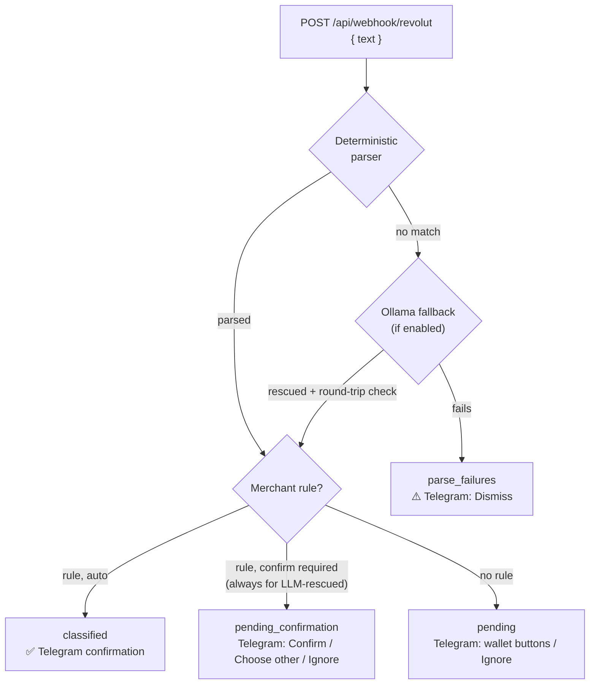

# Using RevBudget

This guide covers day-to-day use: how notifications flow, the Telegram bot, the dashboard, the HTTP API and troubleshooting. For installation, see the [README quickstart](../README.md#quickstart). For production, see [deploy.md](deploy.md).

- [How a notification is processed](#how-a-notification-is-processed)
- [Sending notifications](#sending-notifications)
- [Telegram bot](#telegram-bot)
- [Dashboard](#dashboard)
- [Users and roles](#users-and-roles)
- [Demo mode](#demo-mode)
- [API reference](#api-reference)
- [Maintenance](#maintenance)
- [Troubleshooting](#troubleshooting)

## How a notification is processed



- **Parsing** is a set of bounded regexes over English Revolut notifications (examples [below](#sending-notifications)). Amounts become integer cents. Title lines (`Revolut: …`), balance lines (`Available balance …`), currency parentheticals and a trailing `with card …` are stripped first.
- **Ollama fallback.** When the parser fails and `OLLAMA_ENABLED=true`, a local model rewrites the text into a canonical sentence. The result is fed back through the same deterministic parser, and it's accepted only if that reproduces the model's type, amount and currency. A rescued transaction is never auto-classified: it always waits for a human.
- **Rules** match the normalized merchant (lowercase, single spaces). `exact` rules are checked first, then `contains` rules, which match whole words inside the merchant name.
- **Statuses:**

  | Status | Meaning |
  |---|---|
  | `pending` | Waiting to be classified |
  | `pending_confirmation` | A rule suggests a wallet and waits for you to confirm it |
  | `classified` | Assigned to a wallet |
  | `ignored` | Kept, but excluded from budgets |

  Unparseable notifications aren't transactions. They're kept in a separate `parse_failures` table.
- **Without Telegram** (`TELEGRAM_BOT_TOKEN` or `TELEGRAM_CHAT_ID` unset), processing is the same, minus the messages. Anything that needs a decision waits in the dashboard's Transactions view, where [one-click actions](#one-click-actions) replace the Telegram buttons.

## Sending notifications

The companion Android app (not part of this repository) forwards each Revolut push notification as:

```http
POST /api/webhook/revolut
Content-Type: application/json
X-Webhook-Secret: <WEBHOOK_SECRET>

{ "text": "You paid €12.50 at Corner Bakery", "receivedAt": "2026-09-30T10:15:00Z" }
```

`text` is required (1 to 4096 characters). `receivedAt` is an optional ISO-8601 timestamp and defaults to now. Any client that can send this request works; for testing, use `curl` (see the [quickstart](../README.md#quickstart)).

Recognized formats (currency as `€ $ £` or `EUR USD GBP`, with or without a space before the amount):

| Type | Examples |
|---|---|
| Expense | `You paid €12.50 at Corner Bakery` · `Paid £11.20 at Book Shop` |
| Income | `You received €50.00 from Alex` · `Received €50 from Alex` · `Alex sent you €50` |
| Refund | `You were refunded €9.99 by Online Store` · `Refund of €9.99 from Online Store` · `Online Store refunded you €9.99` · `You've received a payment refund of €9.99 from Online Store` |

The response is `{ "ok": true, "status": "classified" | "pending" | "pending_confirmation" | "parse_failed" }`. The webhook is rate-limited to 60 requests per minute per client IP.

## Telegram bot

Telegram is optional. To enable it:

1. Create a bot with [@BotFather](https://t.me/BotFather) (`/newbot`) and put the token in `TELEGRAM_BOT_TOKEN`.
2. Send your bot any message, open `https://api.telegram.org/bot<TOKEN>/getUpdates`, and copy the numeric `chat.id` into `TELEGRAM_CHAT_ID`.
3. Restart the server.

`TELEGRAM_CHAT_ID` must be your **private chat** with the bot, never a group: everyone in the chat could classify and ignore transactions. Updates from any other chat are dropped, including button presses.

The bot uses long polling (outbound only), so it needs no public URL. Only one instance may poll a given token at a time.

### Messages and buttons

| Situation | Message | Buttons |
|---|---|---|
| No matching rule | 💳 merchant, amount, "Classify:" | One button per active wallet, 🚫 Ignore |
| Rule requires confirmation | 💳 merchant, amount, 🎯 "Rule suggests: *wallet*" | ✅ Confirm, 🔁 Choose other, 🚫 Ignore |
| Rule matched (auto) | ✅ merchant amount → wallet | none |
| Unparseable text | ⚠️ "Could not parse notification" plus the text | 🗑 Dismiss |

- **Tapping a wallet** classifies the transaction. For expenses it also learns an `exact` rule for that merchant, so the next charge from it is classified automatically. The message then shows ↩️ **Undo**, which returns the transaction to pending and deletes the rule it learned.
- **Choose other** lists the other wallets. ↩️ Back returns to the suggestion.
- **Ignore** keeps the transaction but excludes it from budgets.

### Commands

| Command | Reply |
|---|---|
| `/start` | A short greeting |
| `/status` | This month's total, plus spent / budget (%) per active wallet |
| `/wallets` | Active wallets and their monthly budgets |

## Dashboard

Sign in at `/login` (there's no sign-up page; see [Users and roles](#users-and-roles)). Amounts are entered in euros and stored as integer cents. The sun/moon button in the header switches between light and dark themes.

| View | What it's for |
|---|---|
| **Overview** `/` | Month navigator; spent vs. total budget, transaction count and income; one card per wallet with a progress bar (green < 70 %, amber 70–90 %, red ≥ 90 %); latest transactions. Click a card to open the wallet. |
| **Wallets** `/wallets` | Every wallet, active or archived. **+ New wallet**, **Edit** (name, monthly budget, currency, color, emoji, active) and **Delete**. |
| **Wallet detail** `/wallet/:id` | One wallet for the selected month: spent vs. budget, income, a cumulative-spending chart against the budget line, and its transactions. |
| **Transactions** `/transactions` | Filter by month, wallet and status. Rows that need a decision have [one-click actions](#one-click-actions). Click a row to edit wallet, amount, type, status or description. **+ New** adds a manual entry (expense, income, refund or adjustment; an adjustment must reference a related transaction). |
| **Rules** `/rules` | Merchant rules: pattern, match type (`exact` / `contains`), target wallet, and whether Telegram should ask for confirmation. Create, edit and delete. |
| **Stats** `/stats` | Spend per wallet for the month, a 6-month trend per wallet, and the top 5 merchants. |
| **Users** `/users` | Admins only. Invite users and remove them. |

### One-click actions

Transactions that need a decision carry buttons, so you can settle them without opening the edit form. They work on every instance, with or without Telegram:

| Status | Buttons |
|---|---|
| `pending` | **Classify** (pick a wallet), **Ignore** |
| `pending_confirmation` | **Confirm → *wallet*** (accept the rule's suggestion), **Change** (pick another wallet), **Ignore** |

They learn rules the way the Telegram buttons do:

- **Classify** learns an `exact` rule for the merchant of an expense, so the next notification from that merchant is classified automatically.
- **Confirm** and **Change** don't learn a rule, so a rule that requires confirmation keeps asking every time. To stop it asking, turn its confirmation off in **Rules**.
- **Ignore** never learns a rule.

### Common tasks

- **Move a transaction to another wallet.** Transactions → click the row → pick the wallet. For expenses this also updates the merchant's `exact` rule, so future charges follow.
- **Send a transaction back to the queue.** Set its wallet to "—". It returns to `pending`.
- **Pre-classify a merchant** before its first charge. Rules → **+ New rule**. Enter the merchant as it appears in notifications (it's matched case-insensitively). Use `contains` when the merchant string varies, e.g. `bakery` for "Corner Bakery 123".
- **Archive a wallet** instead of deleting it. Untick *Active* in its edit form. It disappears from the Telegram buttons, and its history is kept.
- **Delete a wallet.** Its transactions go back to `pending` and its rules are removed.

## Users and roles

Accounts are invite-only, and public sign-up is disabled.

- **First admin:** `bun run create-admin -- --email you@example.com` (prompts for the password without echoing it), or the one-time `BOOTSTRAP_ADMIN_EMAIL`/`BOOTSTRAP_ADMIN_PASSWORD` variables described in [deploy.md](deploy.md#first-admin). Passwords need at least 12 characters.
- **More users:** an admin opens **Users**, sets the invitee's email, name, initial password and role, and shares the password out of band.
- **Roles:** every signed-in user has full access to wallets, transactions, rules and stats. `admin` additionally manages users. Removing a user ends their sessions immediately.

## Demo mode

An instance running with `DEMO_MODE=true`, such as the public live demo, is a sandbox on fake data. Setting one up is covered in [deploy.md](deploy.md#public-demo-instance-coolify--github-app).

- **One shared login.** Everyone signs in as `demo@example.com` / `revbudget-demo`, a regular user, so there's no **Users** page. Only sign-in, sign-out and session checks work under `/api/auth/*`. Anything else, such as changing the password, returns 403 `demo_locked`.
- **Notification simulator.** The dashboard stands in for the phone. Each sample chip sends its text to `POST /api/demo/notifications`, which runs it through the same pipeline as the webhook. Each sample has a known outcome on fresh demo data (`classified`, `pending`, `pending_confirmation` or `parse_failed`), so you can watch it land and settle it with the [one-click actions](#one-click-actions). The simulator needs a session and is rate-limited.
- **No Telegram, no Ollama.** The server refuses to start with Telegram configured and forces `OLLAMA_ENABLED=false`, so unparseable text is recorded as a parse failure right away.
- **Nightly reset.** At midnight `APP_TIMEZONE`, all data and sessions are wiped and the demo is seeded again, which signs everyone out.

## API reference

Everything under `/api` except `/api/health`, `/api/meta`, `/api/auth/*` and `/api/webhook/*` requires a session cookie (from `POST /api/auth/sign-in/email`). The dashboard calls these routes through a typed client (`hc<AppType>`), so request and response types are checked at compile time.

| Method | Path | Notes |
|---|---|---|
| GET | `/api/health` | `{ "ok": true }` |
| GET | `/api/meta` | `{ demo, demoLogin, resetsAt, samples }`. On a [demo](#demo-mode): `demo: true`, the login as `{ email, password }`, the next reset as ISO-8601, and the simulator's `samples` as `[{ id, label, text, expect }]`. Otherwise `false`, `null`, `null` and `[]`. |
| POST | `/api/demo/notifications` | Demo only, otherwise a JSON 404. Rate-limited. `{ "text": "…" }` (1 to 500 characters) → `{ "ok": true, "status", "transactionId" }`, where `transactionId` is `null` for `parse_failed`. |
| POST | `/api/webhook/revolut` | `X-Webhook-Secret` header. See [Sending notifications](#sending-notifications). |
| POST | `/api/auth/sign-in/email` | Sets the session cookie. 5 attempts/min per IP. |
| POST | `/api/auth/sign-out` | |
| GET | `/api/auth/get-session` | |
| GET · POST | `/api/auth/admin/*` | better-auth admin plugin (`list-users`, `create-user`, `remove-user`, …). Admin role only. |
| GET · POST | `/api/wallets` | |
| GET · PUT · DELETE | `/api/wallets/:id` | DELETE sends the wallet's transactions back to `pending`. |
| GET · POST | `/api/transactions` | GET filters: `month` (`YYYY-MM`), `walletId`, `status`, `type`, `limit` (≤ 500), `offset` |
| GET · PUT · DELETE | `/api/transactions/:id` | PUT with a wallet learns an `exact` rule for expenses, except when confirming or changing a `pending_confirmation` transaction (as in Telegram). |
| GET · POST | `/api/merchant-rules` | |
| PUT · DELETE | `/api/merchant-rules/:id` | |
| GET | `/api/stats/monthly?month=YYYY-MM` | Totals and per-wallet spend for the month |
| GET | `/api/stats/trends` | Last 6 months per wallet, plus the top 5 merchants |

App routes share one error shape: `{ "error": "<code>", "issues"?: [{ "path", "message" }], "requestId": "…" }`. The `/api/auth/*` routes are better-auth's own and answer with its `{ "message", "code" }` shape instead (e.g. `INVALID_ORIGIN`), except for `demo_locked`. Codes include `unauthorized` (401), `validation_failed` (400, with `issues`), `invalid_reference` (400), `not_found` (404), `duplicate` (409), `demo_locked` (403, an `/api/auth/*` route a [demo](#demo-mode) blocks), `demo_full` (403, a demo's creation caps are reached until the reset) and route-specific ones such as `wallet_not_found` or `adjustment_requires_related_tx`. A 5xx is always a generic `internal_error`; quote its `requestId` to find it in the logs.

## Maintenance

| Task | Command |
|---|---|
| Apply migrations | `bun run db:migrate` |
| Insert the 7 default wallets (only if there are none) | `bun run db:seed` |
| Load demo data (refuses when `NODE_ENV=production`) | `bun run db:seed:demo` |
| Create a user from the CLI | `bun run create-admin -- --email <email> [--role admin\|user]` |
| Generate a migration after editing `server/src/db/schema.ts` | `bun run db:generate` |
| Check a deployment's auth end to end | `bun run qa:auth` (see [deploy.md](deploy.md#verifying-a-deployment)) |

To start over locally, stop the server and delete `data/revbudget.db*`. Delete it as a set: the `-wal` and `-shm` files belong to it.

## Troubleshooting

| Symptom | Likely cause |
|---|---|
| Server exits at boot with `[config] Invalid environment variables` | The message names the variable. The usual suspects are a secret under 32 characters or still set to the `.env.example` placeholder, or a missing `DASHBOARD_ORIGIN`/`BETTER_AUTH_URL` in production. |
| Webhook returns `401` | The `X-Webhook-Secret` header is missing or doesn't match `WEBHOOK_SECRET` exactly. |
| Webhook returns `429` | More than 60 requests per minute from one IP. Behind Cloudflare, set `TRUST_PROXY=true`, or every request shares one bucket. |
| Webhook replies `parse_failed` | The text doesn't match a [recognized format](#sending-notifications) (e.g. a non-English notification). It's kept in `parse_failures`. Enable Ollama or add a matcher plus a test in `server/src/services/notification-parser.ts`. |
| Sign-in returns `403` | The browser's origin isn't trusted. Set `DASHBOARD_ORIGIN` to the exact URL you open, and add any others (e.g. a LAN IP) to `TRUSTED_ORIGINS`. |
| Signed in, but bounced back to `/login` in production | The session cookie is `Secure`, so the site must be served over `https://` and `BETTER_AUTH_URL` must be that `https://` URL. |
| Sign-in returns `429` | 5 attempts per minute per IP. Wait a minute. |
| Bot doesn't answer | `TELEGRAM_CHAT_ID` isn't the chat you're writing from (other chats are dropped silently), or the token/chat id is unset. The boot log shows whether the bot started. |
| Telegram logs `409 Conflict` | Two instances are polling the same bot token. Stop the old one (on Coolify, use the *Recreate* deployment strategy). |
| `db:migrate` fails locally | Dev only: delete `data/revbudget.db*` and run `bun run db:migrate` again. |
